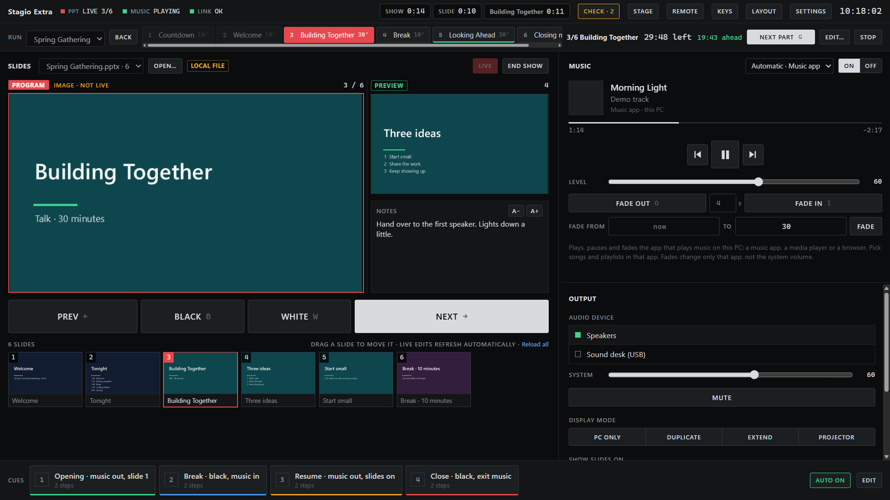

# Stagio

English · [中文](README.zh-CN.md)

**One person runs the whole stage.** Stagio puts the jobs that usually take two or three people at
the back of a room (changing slides, playing music, switching the projector and the sound) on one
screen, and lets you do them from your phone as well.

It drives the PowerPoint and the music player you already have. No accounts, no cloud: everything
runs on the presentation computer, and phones connect to it over the local Wi-Fi (or Bluetooth, or
Stagio's own Wi-Fi when there is none).

Stagio was called **OneDesk** until November 2026. Installing Stagio over OneDesk keeps every
setting (see [Upgrading from OneDesk](#upgrading-from-onedesk)).

**Download and guide: https://ngxu.github.io/stagio/**



## Editions

One program in three sizes. Each edition shows only its own features, so there is nothing to set
up that you will never use. They can be installed side by side and share one data folder, so
moving to another edition keeps your settings, PIN, cues and runs of show.

| | Stagio Lite | Stagio Standard | Stagio Extra |
| --- | --- | --- | --- |
| For | people presenting their own slides | one person running slides, music and the projector | the person running the whole event |
| Slides, black/white screen, notes, timer, true thumbnails, phone remote, pre-show check, speed-up, offline fallbacks | yes | yes | yes |
| Music from any player with fades, volume glides, audio output, projector mode, cues, automatic cues | | yes | yes |
| Headphone preview (Windows): other apps only in your headphones | | basic | full |
| Run of show, opening countdown, stage display for the speaker, messages to the stage | | | yes |

Each edition has its own version number (`editions.json`): Beta 1.0, 1.1, 1.2, 1.2.1, 2.0 …
A fix raises the last number, a new feature the middle one.

## Features

- **Slides**: finds the open PowerPoint, starts and ends the show, next/previous, jump to any slide,
  black and white screen. Shows PROGRAM (what the projector shows), PREVIEW (what comes next),
  speaker notes with adjustable size, animation steps and a show timer.
- **True thumbnails**: every slide as it really looks, cached on disk, updated within seconds when
  someone edits the deck during the show. Hidden slides are marked as hidden, as in PowerPoint.
- **Reorder slides** from the desk: drag a slide to another place; PowerPoint moves it (also
  during a show) and "Save file" keeps the new order.
- **Speed-up** for Canva exports that take seconds per slide in PowerPoint for Windows (decorative
  text in a font without those letters): turns that text into a picture in the same place, so the
  slide looks the same and changes instantly. A backup is kept.
- **Music** (Standard, Extra): whichever app plays it: a music app, a media player or a browser
  (on Windows, anything in the system media controls; on the Mac, Music or Spotify). Play/pause,
  skip, jump within the track, and smooth fades that change only that app: fade out, fade in, or
  from one level to another, without clicks. Stagio follows the app that plays, or the one you pick.
- **Output** (Standard, Extra): Windows audio output device, system volume with glides, projector
  mode (PC only / duplicate / extend / projector only), which screen the show uses, hiding
  PowerPoint's presenter view.
- **Headphone preview** (Windows; basic in Standard, full in Extra): while it is on, the music app
  and PowerPoint stay on the speakers and every other app plays only in your headphones, so you can
  listen to the next song or video before the room hears it. Plugging the headphones in offers to
  turn it on; unplugging turns it off. Extra also picks the speakers device, keeps chosen apps on
  the speakers, sets each app by hand and has a cue step for it. The headphones must be a sound
  device of their own in Windows (USB, Bluetooth, or a separate output of the sound card).
- **Cues** (Standard, Extra): one button for a sequence, for example "fade the music, then start the
  show at slide 1". Keys 1-9, or automatically when a given slide comes up.
- **Run of show** (Extra): the event as a list of parts (countdown, speaker, break, music). Next part
  opens the next deck (prepared in the background), fades the music and switches the projector,
  and the bar shows how far ahead or behind the event is.
- **Opening countdown** (Extra): full screen on the projector, with a title and rotating notices; the
  music can fade out exactly at zero.
- **Stage display** (Extra): a phone or tablet on the lectern shows the current and next slide, the
  notes in large type and the time left. It has its own PIN and can only look. The desk can send
  the speaker a message ("5 minutes left") and sees when it was read.
- **Phone remote**: a web page, nothing to install. Scan the QR code, enter the 6-digit PIN. Keep
  awake, full screen, and the main buttons fixed on screen.
- **No Wi-Fi?** Stagio can open its own Wi-Fi network (Windows), or an Android phone can connect
  over Bluetooth.
- **Pre-show check**: one screen that lists whether the deck, thumbnails, projector, presenter view,
  sound, music, automatic cues and phones are ready.
- **Safe to use live**: double-press protection where it matters, commands that arrived late are
  dropped, and the desk keeps working when a phone or the network drops.

The interface is in English. Windows is the main platform; the Mac version is a test version (see
below).

## Install

| Device | Role | How |
| --- | --- | --- |
| Windows 10/11 PC with PowerPoint (Office 2016 / 365) | the desk | download an installer from the [download page](https://ngxu.github.io/stagio/). Per user, no administrator rights. Any music player for music |
| iPhone, Android phone, tablet | remote, stage display | in Stagio click **Remote** and scan the QR code |
| Mac with PowerPoint for Mac | the desk, **test version** | download the Apple silicon or Intel .dmg |

**Windows "protected your PC" warning**: the installers are not code-signed. Click
*More info → Run anyway*. They are built on GitHub from this repository's source (see the Windows
build workflow); the release notes list each file's SHA-256 if you want to check a download.

**Mac**: not signed by Apple. The first time, right-click the app in Finder and choose Open. If
macOS says the app is damaged: `xattr -cr "/Applications/Stagio Standard.app"` (use the edition
you installed).

### Upgrading from OneDesk

Install the same edition of Stagio (OneDesk Extra → Stagio Extra). It installs over OneDesk as an
ordinary update: same entry in Windows' installed apps, same folder; `OneDesk.exe` is removed and
the Start menu, desktop and taskbar shortcuts become Stagio ones. OneDesk 0.x is taken over by
Stagio Standard. Settings stay where they were, under the old name:

| | Windows | Mac |
| --- | --- | --- |
| settings, PIN, cues, runs of show, backups | `%APPDATA%\OneDesk` | `~/Library/Application Support/OneDesk` |
| thumbnail cache | `%USERPROFILE%\.onedesk\thumbs` | |

Phones that were added to the home screen keep working. Windows Firewall asks once more for
`Stagio.exe`; allow private networks so phones can connect.

## Build from source

Node.js 18 or later.

```bash
npm install
npm start          # the desk in an Edge app window (data in ./data)
npm run app        # the same as a desktop app (Electron)
```

Running from source is Standard; set `STAGIO_EDITION=lite` or `extra` to run another edition.

**Windows installers** (needs NSIS 3; the copy electron-builder downloads into its cache is found
automatically, or set `STAGIO_MAKENSIS`):

```bash
npm run dist:win                                   # all three editions
node build/make-installer.js --edition=extra       # one edition
node build/make-installer.js --no-pack             # installers only, from dist/win-unpacked
```

The installer is our own NSIS script (`build/installer.nsi`), not electron-builder's NSIS target,
because that target runs a freshly built program at build time and some antivirus software blocks
it. The installer writes `resources/edition.json`, which tells the app which edition it is.

**Mac**: `npm run dist:mac` on a Mac (Standard), or the **Mac build** workflow on GitHub, which
builds all three editions for Apple silicon and Intel and checks the Mac helper.

**CI**: `.github/workflows/windows.yml` and `mac.yml` build everything on GitHub's machines (Actions
tab → Run workflow, or push a `v*` tag). The Windows workflow can sign through SignPath if the
repository has SignPath secrets; without them (as now) it builds unsigned.

## Checks

```bash
node test/checks.js                 # helper, config, cues, fades, editions, run of show
node test/checks.js --server        # also a running Stagio (npm run dev) over HTTP
node test/checks.js --no-helper     # without the Windows helper (Mac, CI)
npx electron test/electron-countdown.js
npm run stress -- "D:\path\deck.pptx"   # runs a real slide show (takes over the screen)
```

## How it is built

```
server.js               HTTP server, API, live state to every screen (SSE), PIN login, edition gating
electron/               desktop app: window, shared data folder, one edition at a time, countdown window
lib/edition.js          which edition this is and what it includes (editions.json)
lib/runofshow.js        Extra: run of show
lib/powerpoint.js       Windows: show state, slide list, edit detection, thumbnails
lib/helper.js           Windows: talks to a long-running PowerShell helper (ps/helper.ps1:
                        PowerPoint COM, Core Audio, media keys, show capture, Bluetooth)
lib/platform/mac/       Mac: AppleScript + a small Swift helper (mac/helper/main.swift)
lib/localmusic.js, fade.js               music (any player in the media controls)
lib/output.js, programfeed.js            audio output, projector mode, PROGRAM picture
lib/cues.js, autocues.js                 cues
public/                 the desk (PC, phone, Mac share it), countdown.html, stage.html
build/                  icons and the Windows installer
test/                   checks, stress test
```

Settings live in `data/` when running from source. Never commit that folder: it holds the PIN and
the access keys.

## Known limits

- Keyboard shortcuts work while the desk window is in front.
- Changing the audio output changes the PC's default output.
- Some settings (which screen the show uses, hiding the presenter view, the countdown on a real
  projector, the Mac version with real PowerPoint) have not been tested with every setup yet.
  Try them before an event.

## License

Copyright (C) 2026 ngxu and contributors.

Stagio is free software: you can redistribute it and/or modify it under the terms of the
[GNU General Public License](LICENSE) as published by the Free Software Foundation, either
version 3 of the License, or (at your option) any later version. It is distributed in the hope
that it will be useful, but WITHOUT ANY WARRANTY; see the license for details.

Security problems: see [SECURITY.md](SECURITY.md). Code signing: see the [Code signing policy](CODE_SIGNING_POLICY.md) (the installers are not signed at the moment).
